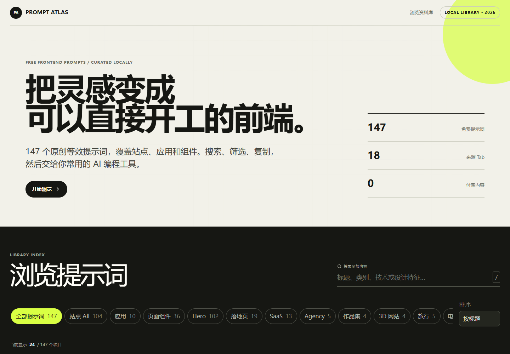
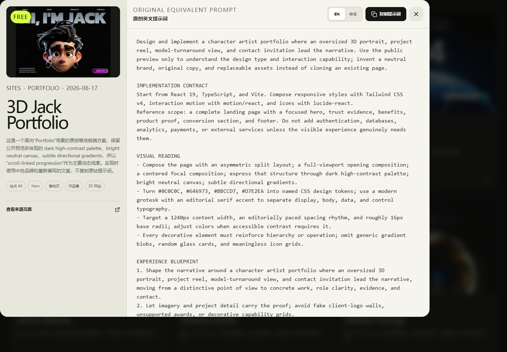
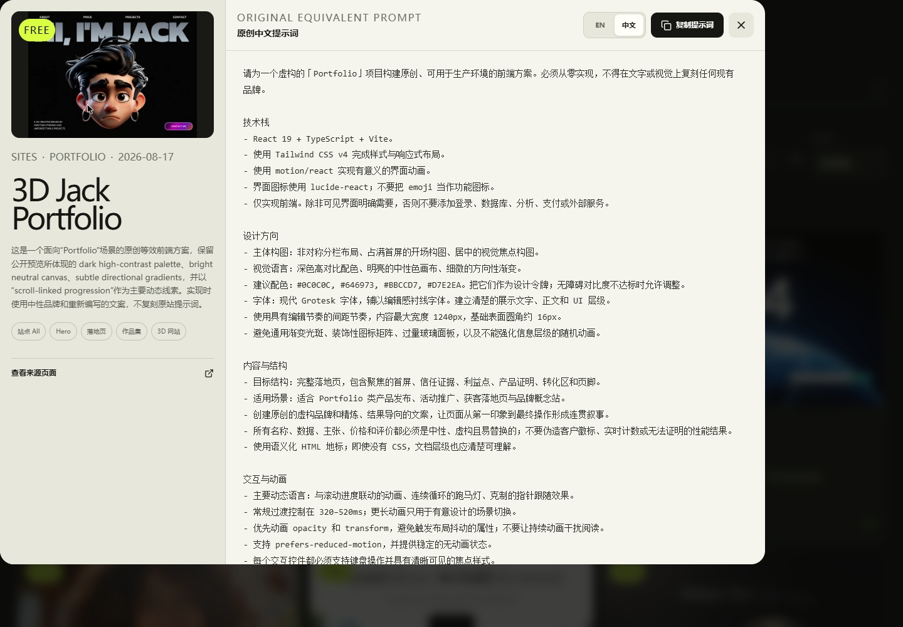
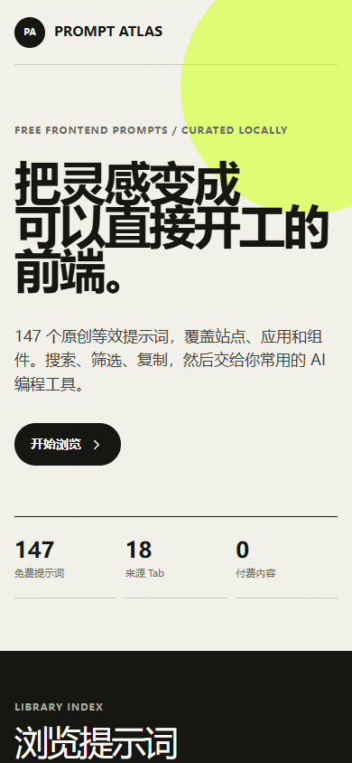
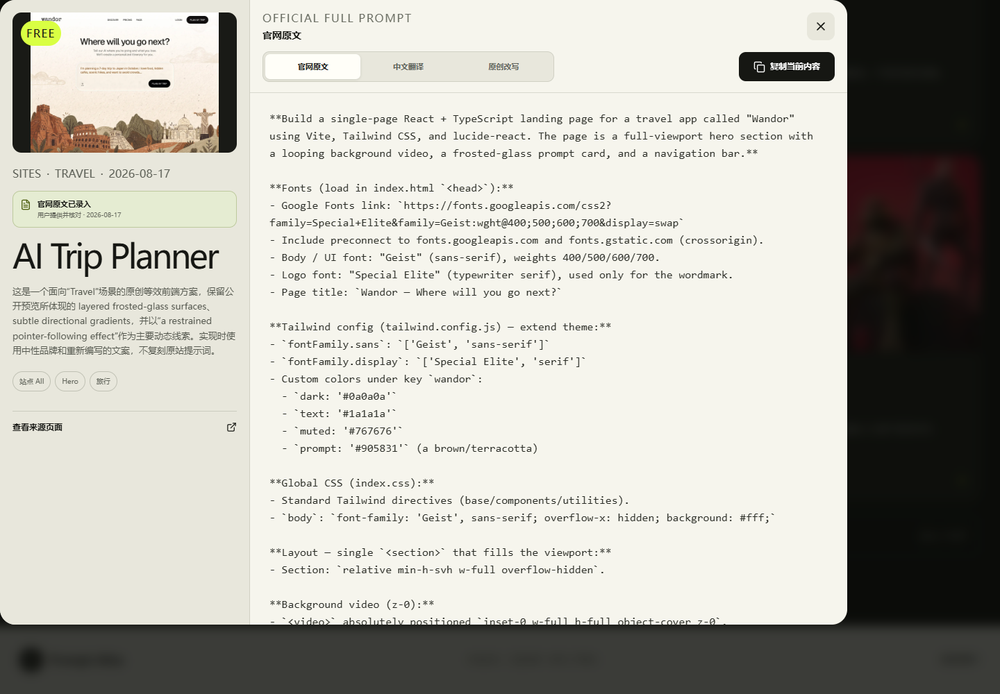
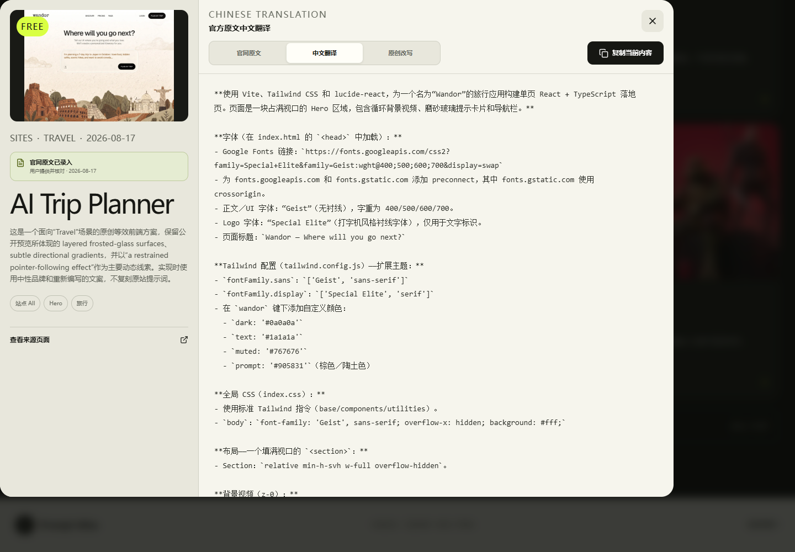
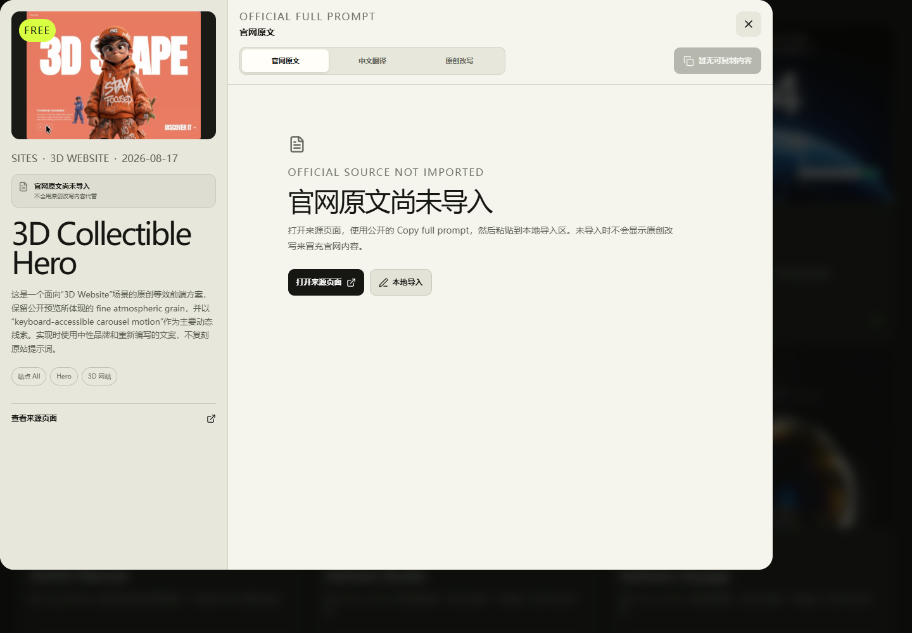
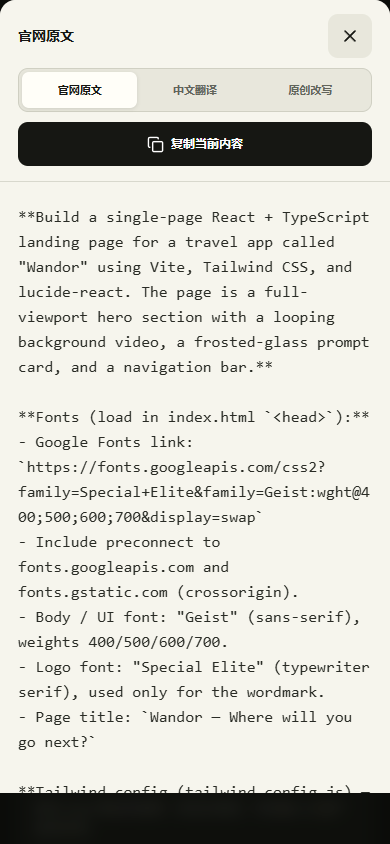

# MotionSites_Prompt

**Prompt Atlas · 免费前端提示词库**

一个本地优先的前端提示词检索网站，包含 147 个免费项目，并把内容明确分成“官网原文、中文翻译、原创改写”三层。项目支持 18 个来源 Tab、全文搜索、分类筛选、完整长文本滚动、一键复制及仅保存在浏览器内的原文导入。



## 项目概览

| 项目 | 当前内容 |
| --- | --- |
| 免费项目 | 147 份，按唯一 ID 去重 |
| 来源分类 | 18 个 MotionSites 页面 Tab |
| 可预览媒体 | 135 个图片或 GIF、12 个 MP4 |
| 官网原文 | 当前内置 1 份：AI Trip Planner，由用户提供并经公开 Copy 流程核对 |
| 中文翻译 | 1 份官网原文完整翻译；147 份原创改写另有中英文版本 |
| 未导入项目 | 146 份明确显示空状态，可由用户粘贴到浏览器本地存储 |
| 运行方式 | 本地 React 前端，无登录、无数据库 |
| 核验日期 | 2026-08-17 |

## 项目截图

以下截图均来自本项目在本地运行时的真实界面。

<table>
  <tr>
    <td></td>
    <td></td>
  </tr>
  <tr>
    <td align="center">桌面端资料库</td>
    <td align="center">英文提示词详情</td>
  </tr>
  <tr>
    <td></td>
    <td></td>
  </tr>
  <tr>
    <td align="center">中文提示词详情</td>
    <td align="center">桌面端首页</td>
  </tr>
</table>

<p align="center">
  
  &nbsp;&nbsp;
  
</p>

<p align="center">390 px 移动端首页与中文详情</p>

### 三层提示词详情

<table>
  <tr>
    <td></td>
    <td></td>
  </tr>
  <tr>
    <td align="center">官网 Full Prompt：6,398 字符</td>
    <td align="center">官网原文完整中文翻译</td>
  </tr>
  <tr>
    <td></td>
    <td align="center"></td>
  </tr>
  <tr>
    <td align="center">未导入不冒充，并提供本地导入入口</td>
    <td align="center">390 px 移动端三层工具栏与长文本</td>
  </tr>
</table>

## 主要功能

- 收录 147 个公开免费项目，不包含 Premium、付费解锁或模板商店内容。
- 详情固定提供“官网原文、中文翻译、原创改写”三个主层；原创改写层另保留 EN／中文子切换。
- 只有真实录入的官网原文才会显示内容；当前内置的 AI Trip Planner 官网原文长度为 6,398 字符，与用户提供并经官网按钮核对的内容一致。
- 其余项目显示“官网原文尚未导入”，复制按钮同步禁用，不会回退到原创提示词造成来源混淆。
- 用户可以把自己通过官网免费 Copy 流程获得的原文及翻译粘贴到本地导入区；内容只保存在当前浏览器的 `localStorage`，支持更新和删除。
- 每个 ID 都有独立产品画像；页面目标、核心组件、信息结构、交互编排和响应式转化不再只靠统一模板替换少量字段。
- 提供 18 个来源 Tab 和“全部提示词”入口，支持搜索、排序与分批加载。
- 搜索范围覆盖标题、分类、中文概述及中英文提示词正文。
- 详情弹窗支持独立下拉滚动、明确的全文结束标记，并适配桌面和移动端。
- 三层内容一键切换；复制按钮始终复制当前层的完整正文，并提供成功或失败反馈。
- 支持 `/` 聚焦搜索、`Esc` 关闭详情、键盘焦点和减少动态效果偏好。
- 所有条目均配置预览媒体；图片、GIF 与视频按媒体类型正确渲染，资源不可用时显示清晰的中文状态。

## 快速开始

环境要求：Node.js 22.13 或更高版本。

```powershell
git clone git@github.com:CWDONG404/MotionSites_Prompt.git
cd MotionSites_Prompt
npm ci
npm run dev
```

终端会显示本地地址，通常为 `http://localhost:5173/`；若端口已被占用，开发服务器会自动选择下一个端口。

## 常用命令

```powershell
# 启动本地开发站点
npm run dev

# 代码检查
npm run lint

# 构建生产版本
npm run build

# 构建并运行数据与页面测试
npm test

# 单独检查数量、必填要求和正文重复度
npm run audit:prompts
```

### 维护者数据命令

正常克隆、运行和构建不需要原始 Markdown 资料库；三层来源状态、已核对样本和 147 条原创中英文数据已提交在 `app/prompt-data.ts`。

维护者如需从采集资料重新生成数据，可把资料库放在相邻目录后运行：

```powershell
npm run prepare:data
```

如需依据已核验视觉特征和逐条产品画像重建 147 份中英文正文，再同步到前端数据：

```powershell
npm run rewrite:prompts
```

默认读取路径为 `../motionsites-free-prompts-2026-08-17/prompts/`。也可以设置 `MOTIONSITES_PROMPT_SOURCE` 指向其他资料目录，再执行生成命令。

## 技术栈

- React 19 + TypeScript
- Vite / vinext
- Tailwind CSS v4
- lucide-react
- Node.js 内置测试运行器

## 数据与预览资源

提示词库以 2026-08-17 可公开访问的 [MotionSites](https://motionsites.ai/) 首页及 Sections 页面为核验范围。初始数据中缺失的 34 个公开预览已从对应来源页补回；两个不适合直接作为卡片媒体播放的 HLS 地址改用了同一公开素材的 Mux WebP 预览。

官网原文层遵循单独的来源状态：仓库只内置用户已经提供、并通过公开 `Copy full prompt` 流程核对的内容。当前样本为 AI Trip Planner；其余 146 项保留来源链接和本地导入能力，不在仓库中整库转载第三方长文本。

预览媒体由第三方来源远程托管，运行时需要联网。若来源日后更换或撤下资源，界面会显示加载失败状态，但本地提示词正文仍可搜索、阅读和复制。

## 核验结果

- 147 个提示词 ID 唯一；三层状态、官网样本、中文翻译及原创中英文正文与 Markdown 错配为 0。
- AI Trip Planner 官网原文为 6,398 字符，完整中文翻译为 5,133 字符；两层均可独立滚动与复制。
- 反模板化门禁：高频模板行中位占比由 V1 的 73.8% 降至中英文各 12.5%。
- 正文平均相似度：英文 24.5%、中文 9.1%；测试会在重复度回升时直接失败。
- 18 个 Tab 索引全部覆盖；无免费项目的分类保留为空状态。
- 147 个预览地址均已配置，前端分别处理图片、GIF 与视频。
- 桌面端与 390 px 移动端已完成视觉检查。
- 6,398 字符官网长提示词可滚动至全文末尾；三层切换、当前层复制、本地导入、更新和删除流程已验证。
- 390 px 下页面、弹窗和工具栏均无横向溢出；浏览器运行时错误为 0。
- 构建、静态检查与自动化测试在提交前执行。

## 归属与使用边界

本仓库是独立的非官方项目，与 MotionSites 及其运营方不存在隶属、授权或合作关系。

- “原创改写”层依据公开预览、分类与交互特征重新编写，不是 MotionSites 站内提示词原文。
- “官网原文”层只收录用户提供且已经明确核对的内容；当前仓库不整库转载其余第三方 Full Prompt。
- 用户在本地导入的内容只保存在自己的浏览器中，不会随仓库提交或上传。
- 本项目不包含 Premium 内容，也不绕过登录、积分、复制次数或付费解锁限制。
- 第三方名称、商标和预览媒体的权利归各自权利人所有；这些媒体不属于本仓库的授权范围。
- GitHub 托管项目源码、用户提供并核对的单份官网样本及原创提示词数据；应用默认在用户本地运行。

## 许可说明

本仓库当前未声明开源许可证。除非另有说明，项目代码与原创提示词保留所有权利；官网原文样本、第三方名称和预览媒体不属于本仓库的许可范围。
